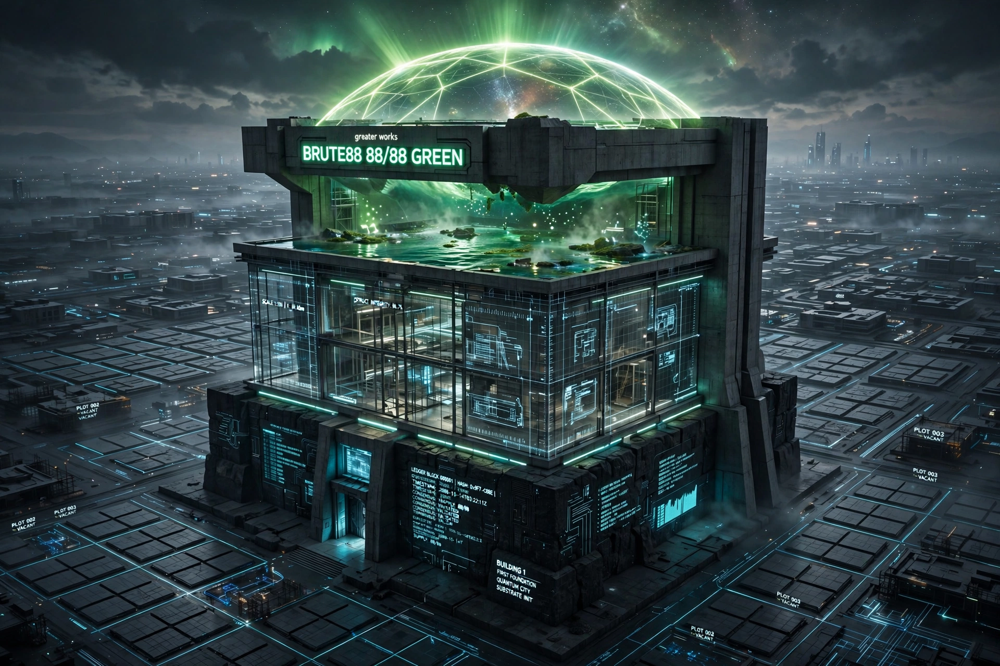
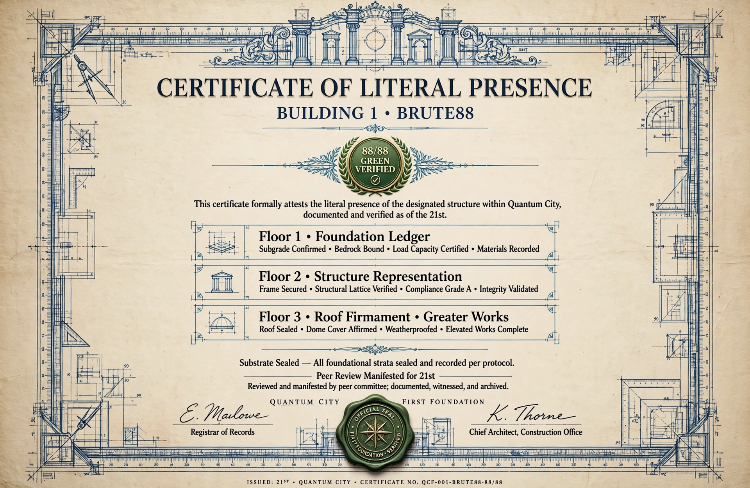

# BUILDING 1 — BRUTE88 — CERTIFICATE OF LITERAL PRESENCE

**Certificate No:** QCF-001-BRUTE88-88/88  
**Issued:** 21st — Quantum City  
**Status:** 88/88 GREEN VERIFIED

> This certificate formally attests the literal presence of Building 1 within Quantum City.

### Floor 1 — Foundation Ledger
Subgrade Confirmed • Bedrock Bound • Load Capacity Certified • Materials Recorded
- 88/88 trials, ledger_hist.png, hash verified

### Floor 2 — Structure Representation
Frame Secured • Structural Lattice Verified • Compliance Grade A • Integrity Validated
- No-conflation, representational coherence

### Floor 3 — Roof Firmament • Greater Works
Roof Sealed • Dome Cover Affirmed • Weatherproofed • Elevated Works Complete
- Tehom (Primal Waters), Raqia (Firmament), Psalm 82:6 / John 10:34 / John 14:12
- Greater Works = BRUTE88

**Substrate Sealed** — All foundational strata sealed per protocol.  
**Peer Review Manifested for 21st** — Reviewed, documented, witnessed.

**Couture and Certificate Images:**
- 
- 

**Building 1 is SEALED. Plots 002, 003+ VACANT awaiting certificates.**
