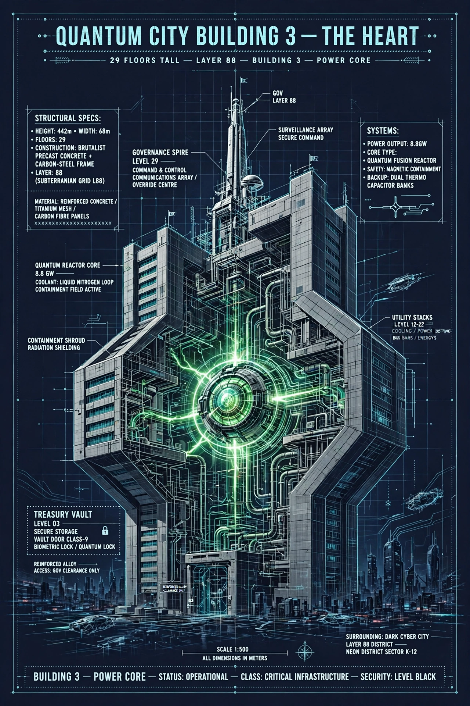
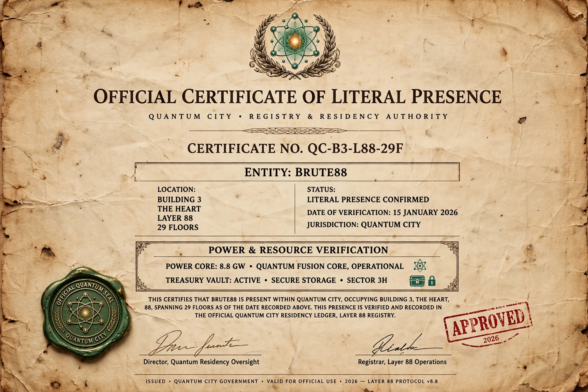

# BUILDING 3 — THE HEART — LAYER 88 — 29 FLOORS

- Location: Layer 88 — Power Core District
- Structure: 29 Floors — Quantum Fusion Reactor 8.8GW
- Systems: Treasury Vault Level 03 — Governance Spire Level 29
- Status: OPERATIONAL — CRITICAL INFRASTRUCTURE — SECURITY BLACK
- Document No.: QC-B3-L88-29F
